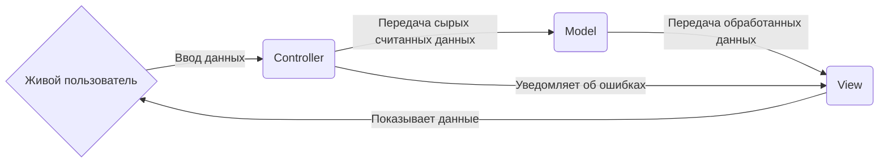
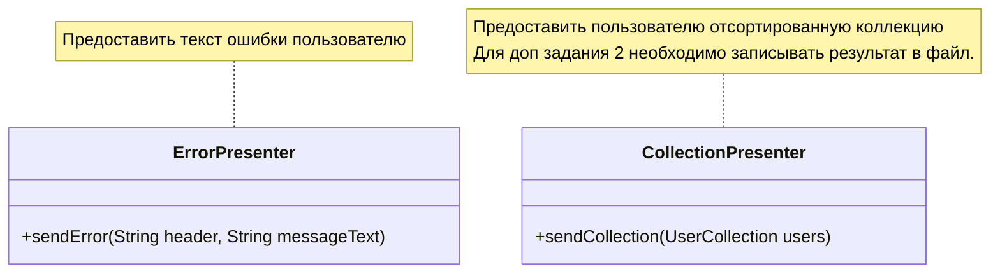
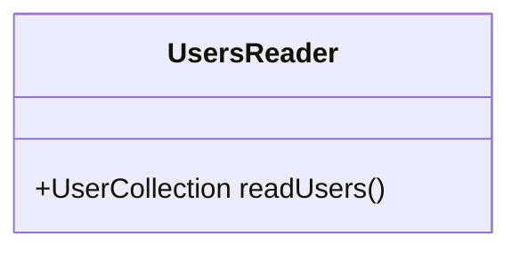
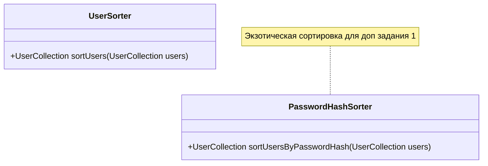
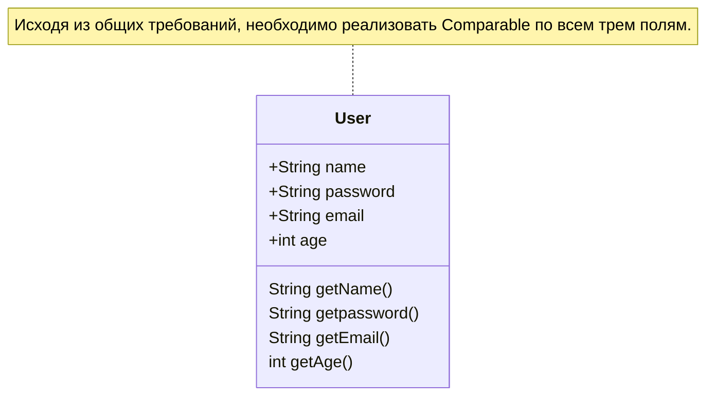
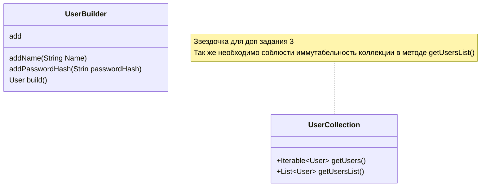

# FirstTeamProject

# Общие конвенции
- Реализация каждого модуля пишется в отдельной папке проекта.
- Реализация каждого подмодуля, если такие появляются при необходимости, пишется в отдельной папке модуля.
- Абстракции пишутся в отдельной папке __abstractions__
- В этом документе описываются API модулей, не их реализация.
- Помним, что один класс может реализовать несколько интерфейсов. Так же помним про остальные принципы SOLID.
- Помним так же и про принцип Dependency Invertion.

# Архитектура

Более уместным и простым будет использовать архитектуру Model View Controller.
На пальцах:
- Controller считывает и заставляет считать Model
- Model считает и заставляет показывать View
- View показывает

Соответственно мы имеем вот такую цепочку зависимостей:

В ТЗ не уточнено, обязательно-ли использовать консоль или можно использовать UI фреймворк. 

Если UI фреймворк использоваться не будет, то View будут отвечать за форматированное красивое отображение данных в консоли и запись в файлы. Controller сооветственно за цикличный ввод данных и соответственно завершение программы.

Если решимся использовать UI фреймворк, то надо будет его адаптировать под архитектуру.

## View
> В данном модуле осуществляется отображение информации пользователю. 
Представление может меняться в зависимости от полученных данных.

Данный модуль должен иметь 2 интерфейса:
  

## Controller
> В данном модуле осуществляется ввод и валидация данных. 
Будь то ввод с клавиатуры, чтение файла и заполнение случайными данными.
Данный модуль отвечает за целостность данных, которые попадают в модель.

Данный модуль должен иметь реализации интерфейсов:

## Model
> В данном модуле осуществляется непосредственно сортировка.
Основная логика, которая должна выполняться эффективно.
Модель получает проверенные данные.

___Важно!___ 
Сортировка должна быть реализована по всем полям.

Можно реализовать комплексную или выборочную сортировку, дополнительное API нужно будет согласовать с исполнителем контроллера.

Данный модуль должен содержать класс:

Так же данный модуль должен содержать реализацию интерфейсов:

## Shared
> В этом модуле представлены объекты, использующиеся повсеместно во всех модулях.

Этот модуль должен содержать классы:

Этот модуль должен содержать реализации интерфейсов:

## Tests
> В данном модуле будет содержаться покрытие кода тестами.

К этому модулю будем приступать в последнюю очередь. В первую очередь нужно будет покрыть тестами сортировку. Ну и возможно валидацию контроллера.
